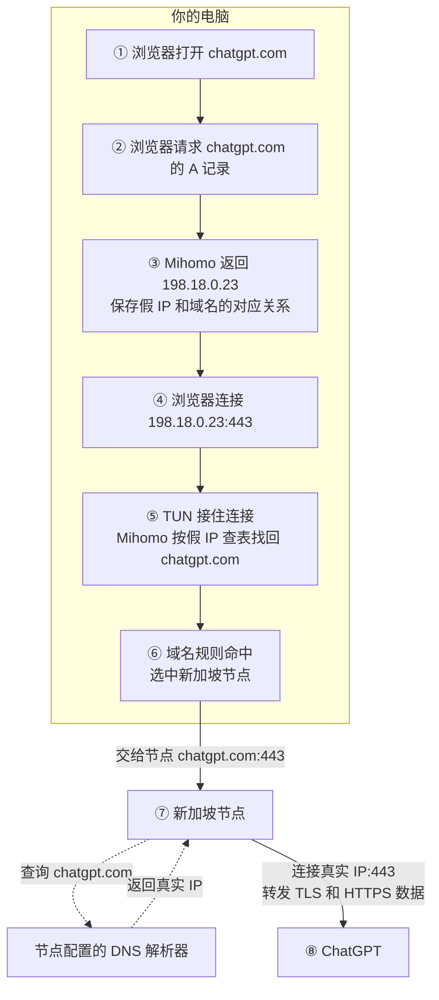
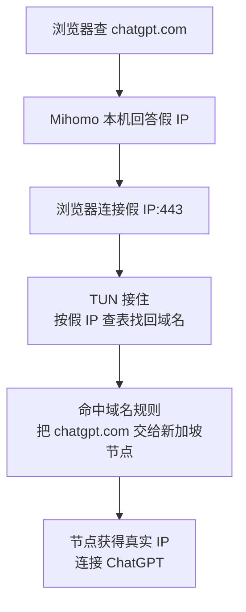
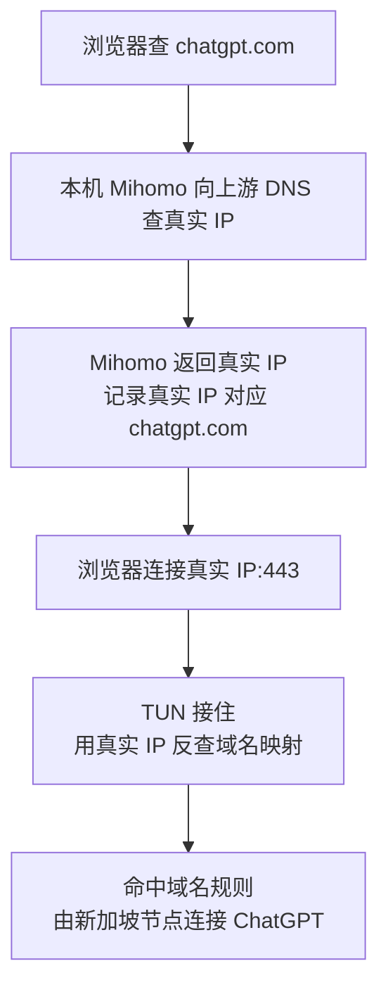
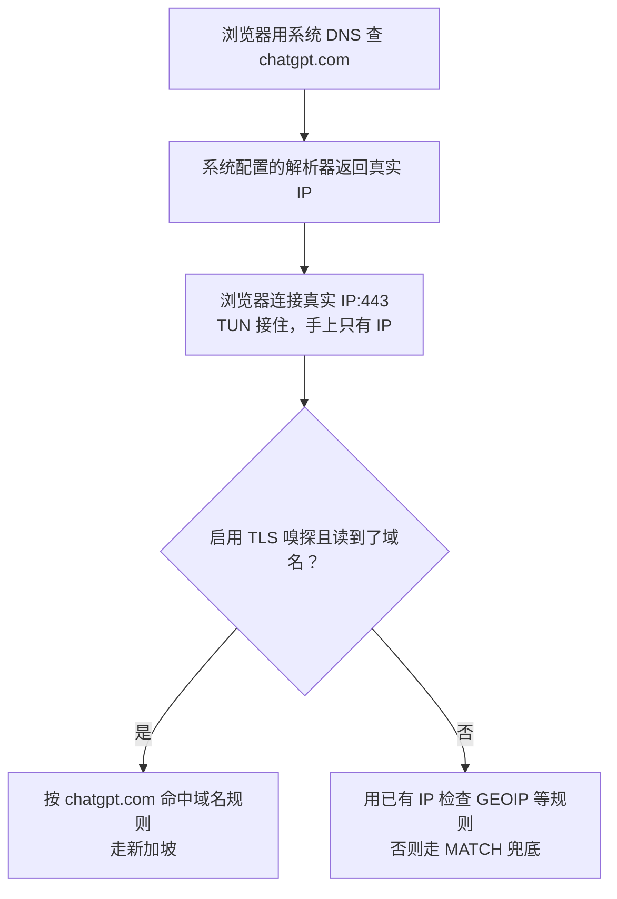
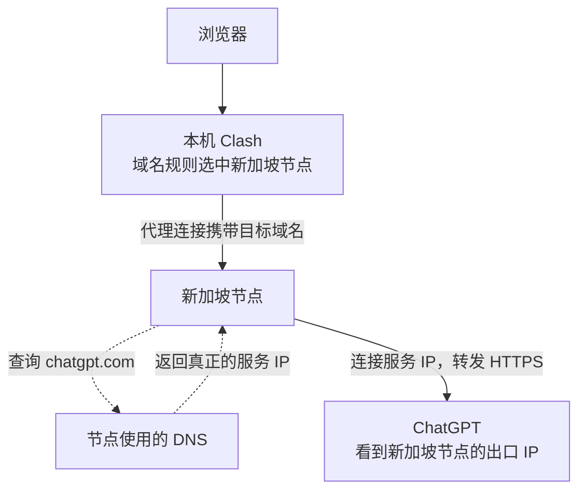
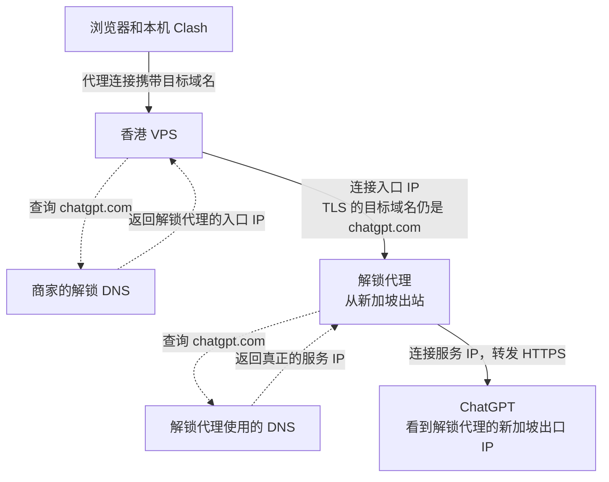

（本文由AI整理和生成）

浏览器打开 `chatgpt.com` 后，Clash 可以把网页流量发给新加坡节点。与此同时，电脑也可能已经向本地运营商查询过这个域名。网页能打开，甚至测到的出口 IP 也在新加坡，这两件事都无法单独说明域名是在哪里解析的。

下面用这次访问串起几个常见问题。浏览器什么时候需要 IP？Clash 从哪里知道域名？`fake-ip` 和 `redir-host` 分别在做什么？DNS 查询如果绕过代理，运营商、解析器和网站各自能看到什么？本文以 Clash 客户端使用 Mihomo 内核为例。

## 一次网页访问有两条路径

在没有可用缓存的情况下，浏览器打开 `https://chatgpt.com/`，通常先要让某一端找到 `chatgpt.com` 的地址。DNS 的 **A 记录**提供 IPv4 地址，**AAAA 记录**提供 IPv6 地址。以普通系统 DNS 为例，电脑把查询交给配置的**递归解析器**。它可以直接返回缓存，也可以向域名的**权威 DNS**查询。递归解析器可以由运营商、公司、公共 DNS 服务商或代理节点使用的网络提供。[IETF《DNS 隐私考量》](https://www.rfc-editor.org/rfc/rfc9076.html#section-1)

拿到目标地址后，才有后面的 TCP、TLS 和 HTTPS 数据交换。走代理时，本机先连代理节点，由节点向网站建立出站连接。代理协议可以接收域名，也可以接收已经解析出来的 IP，所以**查询由哪台机器发起、请求经过哪个网络出口、网站连接由谁发出**，要分别看。[curl 客户端和代理端解析示例](https://curl.se/docs/manpage.html#--socks5-hostname) · [Shadowsocks 协议](https://shadowsocks.org/doc/what-is-shadowsocks.html)

## Fake IP 如何让 Clash 按域名分流

TUN 是系统中的虚拟网卡。浏览器按普通网络方式发起连接，系统路由把相关流量交给 TUN，Mihomo 接着判断出口。问题在于，TCP 连接的目标通常表现为一个 **IP 加端口**。单凭这个地址，Clash 未必能知道浏览器原先输入了哪个域名。Mihomo 可以接管普通 DNS 查询，并在回答时建立一条地址和域名的对应关系。[Mihomo TUN 文档](https://wiki.metacubex.one/config/inbound/tun/#dns-hijack) · [连接处理源码](https://github.com/MetaCubeX/mihomo/blob/Meta/tunnel/tunnel.go#L269)

假设 `a.example` 和 `b.example` 共享一个 CDN 地址。下面的 IP 只用来说明流程。

| 浏览器访问  | 示例真实 IP    | Mihomo 分配的假 IP | 期望出口   |
| ----------- | -------------- | ------------------ | ---------- |
| `a.example` | `203.0.113.10` | `198.18.0.23`      | 新加坡节点 |
| `b.example` | `203.0.113.10` | `198.18.0.24`      | 直连       |

如果浏览器直接拿到真实地址，两条连接的目标都写着 `203.0.113.10:443`。开启 `fake-ip` 后，Mihomo 先给两个域名各分配一个假地址。浏览器连 `.23` 时，Mihomo 从自己的映射表找回 `a.example`。浏览器连 `.24` 时，找回的是 `b.example`。查这张表只需要本机已有数据，也无需等到 TLS 握手再读取域名。示例中的假地址来自特殊用途地址空间，Mihomo 会在接管连接后使用映射找出实际目的地。[Mihomo Fake IP 实现](https://github.com/MetaCubeX/mihomo/blob/Meta/dns/middleware.go#L141) · [IANA IPv4 特殊用途地址登记](https://www.iana.org/assignments/iana-ipv4-special-registry/iana-ipv4-special-registry.xhtml)

### 输入 chatgpt.com 后发生了什么

以下先跟踪一种常见情形。浏览器发起一次没有缓存的 IPv4 查询，Mihomo 的 DNS 和 TUN 都接管成功，域名规则在 IP 规则前面，代理协议支持把目标域名交给节点。图中采用 TCP HTTPS，虚线表示节点对上游的 DNS 查询和应答。



第 ②～③ 步里，**浏览器确实问了 DNS**，但 Mihomo 在本机就能回答假 IP，这一步不需要向上游问真实地址。第 ④～⑤ 步，浏览器把假地址写进连接的目的地，TUN 将连接交给 Mihomo，Mihomo 用映射找回域名。第 ⑦～⑧ 步才需要网站的真实 IP，图里的新加坡节点用自己的 DNS 解析或使用已有缓存，然后连接网站。对浏览器而言，TLS 的目标仍是 `chatgpt.com`，并按这个域名验证网站证书。[Mihomo 解析流程](https://wiki.metacubex.one/config/dns/diagram/) · [Shadowsocks 协议](https://shadowsocks.org/doc/what-is-shadowsocks.html)

连接代理节点本身也可能需要 DNS。例如订阅里节点的 `server` 是一个域名，Mihomo 需要先知道节点地址，才能把 `chatgpt.com` 交给节点。`proxy-server-nameserver` 专门用于解析这类**节点域名**，例如 `sg-node.example`。抓包时要区分你看到的是节点域名还是目标网站域名。[Mihomo DNS 配置](https://wiki.metacubex.one/config/dns/#proxy-server-nameserver)

## 规则顺序和 no-resolve 如何影响查询

在 **Rule 模式**下，Mihomo 从上往下检查规则。假设下面的 `新加坡` 与 `默认代理` 都是已存在的策略组，示例只展示分流规则。

```yaml
rules:
  - DOMAIN,printer.lan,DIRECT
  - DOMAIN-SUFFIX,chatgpt.com,新加坡
  - GEOIP,CN,DIRECT,no-resolve
  - MATCH,默认代理
```

当 Mihomo 从假 IP 映射找回 `chatgpt.com`，第一条 `DOMAIN` 要求完整域名等于 `printer.lan`，因此跳过。第二条 `DOMAIN-SUFFIX` 匹配 `chatgpt.com` 本身及其子域名，于是选中新加坡，后面的规则不再检查。如果没命中域名规则，后续才可能轮到 `GEOIP` 或 `MATCH` 兜底。[Mihomo 路由规则](https://wiki.metacubex.one/config/rules/)

同一条访问，移动 `GEOIP` 的位置就能改变 DNS 行为。

| 到达规则时手里只有域名                  | Mihomo 怎么处理                                                                                                    |
| --------------------------------------- | ------------------------------------------------------------------------------------------------------------------ |
| `DOMAIN-SUFFIX,chatgpt.com,新加坡` 在前 | 比较域名就能命中，直接选择新加坡。                                                                                 |
| `GEOIP,CN,DIRECT` 在前                  | 为了判断目标 IP 是否归入 `CN`，Mihomo 会先尝试解析真实 IP。匹配 `CN` 就直连，未匹配才继续检查 ChatGPT 的域名规则。 |
| `GEOIP,CN,DIRECT,no-resolve` 在前       | 手上只有域名时，跳过这条规则，然后命中 ChatGPT 的域名规则。若本来就有真实 IP，这条 IP 规则仍能照常检查。           |

**`no-resolve` 只禁止这一条目标 IP 规则为了匹配而主动解析。** 浏览器之前发起的 DNS 查询、直连时必需的解析、节点自己发起的解析，都有各自的流程。若上面的 `GEOIP` 已经触发了一次查询，后面即使选了新加坡，之前那次查询也可能已经发出。此外，给所有目标 IP 规则加上 `no-resolve` 后，有些只靠 IP 归属识别的国内站点会落到兜底策略。[Mihomo `no-resolve` 文档](https://wiki.metacubex.one/config/rules/#no-resolve)

## 三种方式对比

Mihomo 内置 DNS 的 `enhanced-mode` 有 `fake-ip` 和 `redir-host` 两种，默认是 `redir-host`。只删掉 `enhanced-mode: fake-ip`、同时保留内置 DNS 时，就会落到这个默认模式。为了对比三条不同路径，这里把第三种情况设为**浏览器走系统 DNS，Mihomo 只通过 TUN 接管网页连接**。[Mihomo DNS 配置](https://wiki.metacubex.one/config/dns/#enhanced-mode)

### 内置 DNS 使用 fake-ip



前提是查询命中 Fake IP 处理、前置规则没有要求真实 IP、节点可以在远端解析。若目标命中 `fake-ip-filter` 的真实解析例外，或者规则最终选了 `DIRECT`，本机 Mihomo 就可能需要查询真实地址。`fake-ip-filter` 常被用来让依赖真实地址的局域网名称或应用走正常解析。[Mihomo `fake-ip-filter` 文档](https://wiki.metacubex.one/config/dns/#fake-ip-filter)

### 内置 DNS 使用 redir-host



**第一次真实地址查询由本机 Mihomo 发起。** 它回答浏览器时，也会记下获得的真实 IP 对应哪个域名。随后 TUN 接到连接，可以用这条记录找回域名。两个域名共用一个真实 IP 时，按 IP 保存的映射可能被覆盖。映射过期、查询由其他程序处理等情况也可能让 Clash 缺少域名。开启适用的嗅探规则可以补充这一信息。[Mihomo 真实 IP 映射实现](https://github.com/MetaCubeX/mihomo/blob/Meta/dns/middleware.go#L93) · [域名嗅探文档](https://wiki.metacubex.one/config/sniff/)

域名规则一旦匹配，后面由哪个地址真正连接网站，仍取决于代理协议和配置。Mihomo 若把域名交给节点，节点可能再解析一次。第一次查询虽然源自本机 Mihomo，它向上游 DNS 发起的连接仍可配置为走代理。[Mihomo 解析流程](https://wiki.metacubex.one/config/dns/diagram/) · [DNS 出站配置](https://wiki.metacubex.one/config/dns/#respect-rules)

### 系统 DNS 解析，TUN 接管网页连接



这一路径由**系统配置的 DNS**先给浏览器真实 IP。Mihomo 没处理查询，就没有为它建立映射。若开启 TLS 嗅探且可读到握手里的服务器名称 **SNI**，域名规则仍可参与匹配。嗅探是否把域名用于实际连接，由 `override-destination` 等设置决定。嗅探失败时，已有的真实 IP 仍可用于 `GEOIP` 或 `IP-CIDR` 等规则。这个例子使用 TUN。如果浏览器显式通过 HTTP CONNECT 或支持传域名的 SOCKS 代理提交连接，代理入站也可以直接收到目标域名。[Mihomo 域名嗅探](https://wiki.metacubex.one/config/sniff/#parse-pure-ip) · [curl 代理选项](https://curl.se/docs/manpage.html#--socks5-hostname)

## DNS 泄露是什么，会暴露哪些信息

DNS 泄露取决于你原先期望的路径。假如你希望 `chatgpt.com` 由远端节点解析，结果电脑额外把这个域名明文发给了家用路由器或运营商 DNS，就发生了泄露。**网页流量完全可以同时走新加坡。** 如果你有意让某些直连域名使用本地 DNS，这些域名的查询就符合你的分流策略。[V2EX 的规则分流讨论](https://www.v2ex.com/t/1137959) · [IETF《DNS 隐私考量》](https://www.rfc-editor.org/rfc/rfc9076.html)

常见的外发路径包括系统代理只接管网页连接、浏览器或应用独立解析、前置 IP 规则触发真实地址查询，以及 VPN 切换时系统短暂回到普通网络。浏览器也可能使用自己的 DoH，绕过 Mihomo 的 DNS 模块。此时要看 DoH 连接本身从哪个出口发出。[AirVPN 的 DNS 泄露说明](https://ipleak.net/) · [Mullvad 的 VPN 切换实测](https://mullvad.net/en/blog/dns-traffic-can-leak-outside-the-vpn-tunnel-on-android)

| 谁在观察                  | 一般能看到什么                                                                                                                                                                             |
| ------------------------- | ------------------------------------------------------------------------------------------------------------------------------------------------------------------------------------------ |
| 本地网络或运营商          | 普通明文 DNS 中的查询域名、时间等信息。直连加密 DNS 时，通常能看到你连了哪个解析器，查询里的具体域名受加密保护。                                                                           |
| 接收查询的递归 DNS 服务商 | 查询域名、查询时间和连接来源 IP。即使用 DoH 或 DoT，这个服务商仍须解开请求才能解析。                                                                                                       |
| 域名的权威 DNS            | 递归解析器需要向它查询时，通常看到的是递归解析器的 IP。缓存可能使查询根本到不了权威 DNS。若携带 EDNS Client Subnet（ECS），它还可能收到客户端 IP 的部分网段，供 CDN 等服务选择合适的节点。 |
| 接收网页连接的目标网站    | 网页连接从新加坡代理发来时，网站看到的是代理出口 IP。仅凭一般的权威 DNS 查询记录，通常无法直接把你的本地 IP 和代理过来的网页请求对应起来。                                                 |

DNS 查询可能由预加载、后台应用、页面内嵌资源触发，因此一条查询记录只能说明域名被查过。完整的 HTTPS 页面路径、搜索词、密码和聊天内容通常在网页连接里，DNS 查询一般只包含域名及相关查询字段。[IETF DNS 隐私考量](https://www.rfc-editor.org/rfc/rfc9076.html#section-4.2) · [权威 DNS 的观察范围](https://www.rfc-editor.org/rfc/rfc9076.html#section-6.2) · [ECS 规范](https://www.rfc-editor.org/rfc/rfc7871.html#section-11.1)

**DNS 污染是回答被干预的问题。** 如果某次解析返回伪造 IP，而代理客户端信了这个结果，可能导致连错地址、访问失败，或者让依赖目标 IP 的分流选错出口。泄露关注查询去了哪里，污染关注返回的答案。**DoH 和 DoT 则保护设备到指定解析器之间的查询内容**。是否加密、由哪个解析器处理、这条连接是否经过代理，可以独立配置。[IETF DoH 规范](https://www.rfc-editor.org/rfc/rfc8484.html#section-8) · [IETF DoT 规范](https://www.rfc-editor.org/rfc/rfc7858.html)

### 如何理解论坛里的两种配置

V2EX 有一条评论，把配置简化为 **TUN 严格路由、`fake-ip`、一个运营商 DNS、目标 IP 规则加 `no-resolve`**。以 Windows 为例，开启自动路由后，`strict-route` 会添加防火墙规则，限制 Windows 的常规多网卡 DNS 绕行。被接管的地址查询可以由 Mihomo 本地回答假 IP，后续再按域名选节点。这样即使设置了运营商上游 DNS，ChatGPT 的域名也可以在这个流程里直接交给代理节点。需要真实地址的直连或例外域名仍可能使用该上游。浏览器的独立 DoH、例外域名和实际出站配置都会影响结果。[V2EX 原帖第 8 楼](https://www.v2ex.com/t/1137959) · [Mihomo 严格路由](https://wiki.metacubex.one/config/inbound/tun/#strict-route)

另一篇 NodeSeek 帖子用的是 **`redir-host` 加 DNS 分流**。虽然 YAML 同时写了 `fake-ip-range`，决定应答方式的字段是 `enhanced-mode: redir-host`。配置里的 `nameserver-policy` 为指定域名选择上游解析器，`respect-rules` 让**到解析器的连接**遵守路由规则，`proxy-server-nameserver` 用来先解析代理节点本身。两套方案均可达到「目标域名查询不从本地直出」的效果，实际结果取决于具体流量如何命中规则。配置了 `fallback` 时，尤其要区分**最终用了哪个应答**和**查询曾发给哪些解析器**，某些设置下主、备解析器会同时收到查询。[NodeSeek 原帖](https://www.nodeseek.com/post-618068-1) · [Mihomo DNS 配置](https://wiki.metacubex.one/config/dns/) · [Mihomo 解析流程](https://wiki.metacubex.one/config/dns/diagram/)

## 如何验证 chatgpt.com 有没有从本地查出去

### ipleak 适合初筛

ipleak 会让浏览器触发对 `*.ipleak.net` 测试域名的解析，再列出响应本次测试的解析器。它能帮助判断默认解析行为。在 Clash 按域名分流时，测试域名和 `chatgpt.com` 可能命中不同的规则。测试页显示运营商 DNS，只能说明某些测试查询走到了它。换成境外 DNS 也只能说明测试域名的情况。解析器的国旗和网页的出口 IP 都无法单独证明 `chatgpt.com` 的 DNS 路径。[ipleak 的 DNS 检测说明](https://ipleak.net/)

### 在 Windows 上对实际域名抓包

1. **保留平时的代理和浏览器 DNS 设置。** 在 Wireshark 选择实际联网的 Wi-Fi 或以太网。需要对照时，也可同时抓 TUN 网卡。完全退出浏览器，执行 `ipconfig /flushdns`，再重新打开浏览器，访问 `https://chatgpt.com/`。这个命令清理 Windows DNS 客户端缓存，浏览器或代理内核仍可能有各自的缓存。测试时在 Clash 连接页记录域名命中的规则和网页出口。[Microsoft `ipconfig` 文档](https://learn.microsoft.com/en-us/windows-server/administration/windows-commands/ipconfig)
2. **筛选目标域名的明文查询。** 在 Wireshark 的显示过滤器输入下方表达式。若在物理网卡上看到查询发往路由器、运营商或公共 DNS，就拿到了这次查询从本机明文出网的证据。只在 TUN 网卡看到查询，说明本地虚拟网卡接到了它，还要查物理网卡上的外发情况。[Wireshark DNS 字段参考](https://www.wireshark.org/docs/dfref/d/dns.html)
3. **对没有结果的抓包分情况解释。** 过滤器没有结果，表示本次未观测到对应的明文 DNS。缓存、DoH 或远端解析都可能出现这个结果。开着浏览器安全 DNS 时，结合浏览器网络日志确认是否查过 `chatgpt.com`，再看 DoH 连接本身走直连还是代理。要确认远端节点是否收到域名并发起查询，可对照自己有权限查看的节点日志、DNS 解析日志或节点侧抓包。仅有本机侧证据时，可以分别确认观察到的明文查询和网页出口，节点端是否真的查询还要看节点侧证据。[IETF DoH 规范](https://www.rfc-editor.org/rfc/rfc8484.html) · [Mihomo 解析流程](https://wiki.metacubex.one/config/dns/diagram/)

```text
dns.flags.response == 0 && dns.qry.name == "chatgpt.com"
```

这个过滤器只看 `chatgpt.com` 本身。如果想检查整次页面加载，还要查看它访问的其他子域名和相关域名。手动跑 `nslookup chatgpt.com` 可以生成一次独立的查询做对照，实际浏览器可能走自己的缓存或 DoH，复现时仍应使用平时打开网页的方式。[Microsoft DNS 客户端排查](https://learn.microsoft.com/en-us/windows-server/networking/dns/troubleshoot/troubleshoot-dns-client)

## VPS 的 DNS 解锁又是什么

在 VPS 测评里，**原生解锁**通常表示服务接受该 VPS 自己的出口 IP。**DNS 解锁**的一种常见实现则是让 VPS 用商家的解锁 DNS。这个 DNS 对特定域名返回**解锁代理的入口 IP**，VPS 按应答去连接，再由解锁代理从另一个能访问目标服务的出口发出请求。因此同一台香港 VPS 测 ChatGPT 时可能显示新加坡，测其他服务时仍使用香港出口。地区和解锁标签反映具体检测及当时路径。[NodeSeek VPS 测评示例](https://www.nodeseek.com/post-403625-1) · [SNI 代理开源实现](https://github.com/mosajjal/sniproxy#how-it-works)

### 在 Clash 里直接指定新加坡节点



### 先连香港 VPS，再由 VPS 使用解锁 DNS



第二张图以 SNI 代理为例。解锁 DNS 用自己的应答把连接引到代理，代理读取 TLS 握手中的 SNI，据此连接目标服务。若直接在香港 VPS 上执行测评，流程从香港 VPS 开始。第一张图里的选路来自 Clash 规则，第二张图还多了由 DNS 应答引导的一段连接。Fake IP 的临时地址用于把连接交回本机 Mihomo，解锁 DNS 给出的入口地址用于连接远端解锁代理。[SNI 代理开源实现](https://github.com/mosajjal/sniproxy#how-it-works) · [Mihomo 连接处理实现](https://github.com/MetaCubeX/mihomo/blob/Meta/tunnel/tunnel.go#L272)

按这两张图，如果本机没有另外发出目标域名的查询，那么两条访问链路都没有从本机泄露 `chatgpt.com` 的 DNS 查询。第二条里的解锁 DNS 是香港 VPS 按约定使用的解析器，因此这个服务商能看到查询，通常也能看到香港 VPS 的来源 IP。若本机浏览器或 Clash 另外通过本地网络查了 `chatgpt.com`，即使最终仍由新加坡出站，也要把那次本地查询算进去。[IETF DNS 隐私考量](https://www.rfc-editor.org/rfc/rfc9076.html#section-4.2)
