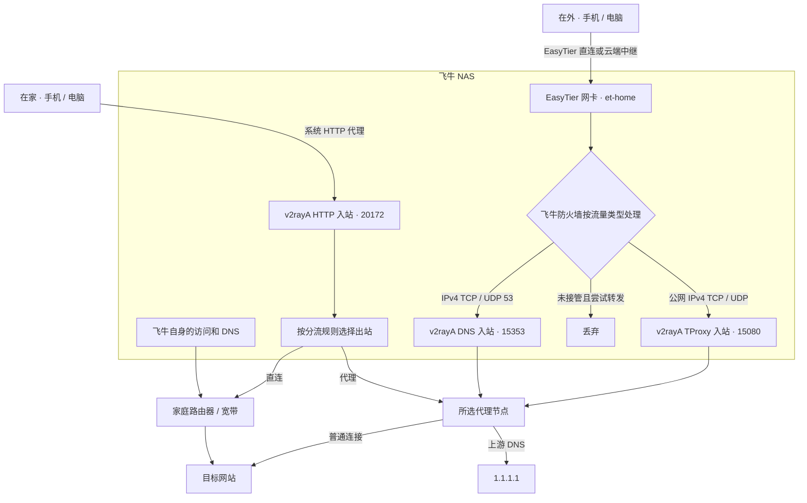
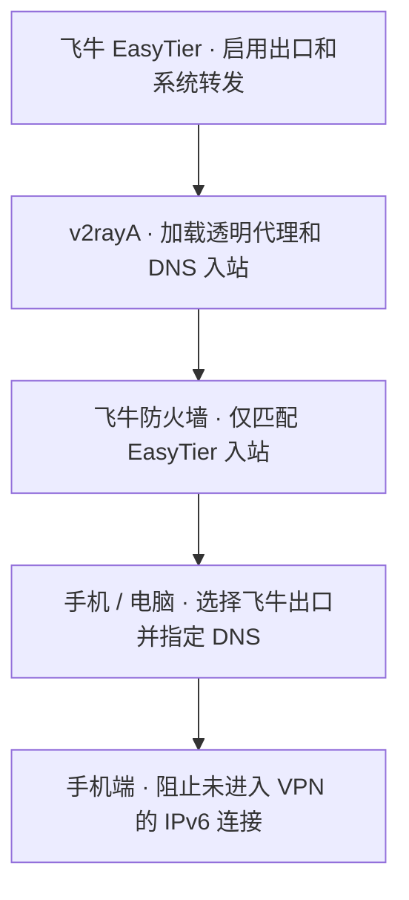

（本文由 AI 协助整理）

飞牛上已经装了 EasyTier 和 v2rayA。在家，可以给手机和电脑填一个局域网代理地址。出门后，也可以通过 EasyTier 连回这台 NAS。如果希望出门时只开 EasyTier，连不支持系统代理的应用也能走飞牛，就需要把飞牛收到的流量交给 v2rayA。本文记录的是方案设计。EasyTier 的 IPv6 组网已经验证，透明代理方案和纯 IPv6 代理节点还未完成实测。

## 需求分析

现有架构里，飞牛的家庭 LAN 地址是 `192.168.1.108`。EasyTier 直接装在飞牛系统上，v2rayA 在 Docker 中使用 `host` 网络，并已导入代理节点。另有一台带公网 IP 的云服务器，用于节点发现、打洞和必要时的中继。终端是一台手机和一台电脑，家庭路由器已向 LAN 下发公网 IPv6 地址。

- **飞牛自身直连。** 文件服务、更新和系统 DNS 继续走家庭路由器。只对指定终端送来的流量提供代理。
- **在家按需代理。** 手机和电脑通过系统设置填写飞牛的 HTTP 代理地址，由支持系统代理的应用使用它。
- **出门后仍能使用飞牛。** 支持手填代理的应用可以直接访问飞牛的虚拟网 IP。需要覆盖普通应用时，让 EasyTier 接管客户端的 IPv4 默认路由，飞牛负责透明代理。
- **分清 IPv6 和 DNS 的边界。** EasyTier 可以通过公网 IPv6 打洞，飞牛也可以通过 IPv6 连接上游节点。手机自身发起的 IPv6 网站连接和 DNS 查询能否进隧道，需要另看客户端路由。

原配置使用 `172.168.31.13` 作为飞牛的 EasyTier 虚拟地址。这个地址落在 RFC 1918 范围之外，容易让虚拟路由与公网目的地址冲突。`172` 开头的私有范围只有 `172.16.0.0/12`。下面用 `10.77.31.13` 举例，它代表迁移后的飞牛地址。实际选网段时还要避开家庭 LAN、Docker 和其他 VPN 使用的地址。 [IANA 私有地址范围](https://www.iana.org/help/private-addresses)

## 方案设计

### 在家和外面使用显式代理

在 v2rayA 里开启「局域网共享」。按默认端口，`20170` 是 SOCKS5，`20171` 是普通 HTTP，`20172` 是按规则分流的 HTTP。家庭 Wi-Fi 下可填写 `192.168.1.108:20172`。出门连上 EasyTier 后，可把支持手动设置代理的电脑或应用指向 `10.77.31.13:20172`。此时 EasyTier 只需让客户端访问飞牛的虚拟地址。手机上为家庭 Wi-Fi 填的代理不会跟到蜂窝网络，系统代理也只覆盖遵循该设置的应用。 [v2rayA 快速上手](https://v2raya.org/docs/prologue/quick-start/) · [Windows 代理设置](https://support.microsoft.com/zh-cn/windows/experience/connectivity-networking/use-a-proxy-server-in-windows) · [Apple 全局 HTTP 代理说明](https://support.apple.com/guide/deployment/filter-content-dep1129ff8d2/1/web)

### 外出使用 EasyTier 出口和 TProxy

客户端选中飞牛为出口后，EasyTier 把发往公网的 IPv4 包送到飞牛。比如一条 HTTPS 连接，包的目的仍是网站 IP 和 `443` 端口。v2rayA 的 `20172` 需要客户端主动发送 HTTP 代理请求，因此这类包需要经过 Linux 的 TProxy，进入可以读取原始目的地址的透明代理入站。DNS 则通过另一条规则交给专用入站。 [EasyTier 出口配置](https://easytier.cn/guide/network/configurations.html) · [Linux TProxy](https://docs.kernel.org/networking/tproxy.html) · [Xray 透明代理入站](https://xtls.github.io/en/config/inbounds/tunnel.html)

不加 WireGuard 的方案保留 EasyTier 原有直连和中继能力，也能接管客户端的普通 IPv4 应用流量。调研时，EasyTier 的标准出口链路仍缺少可依赖的 `::/0` 接管。讨论过用 WireGuard 和 sing-box 补齐双栈全隧道，但本文采用 EasyTier 自带的 IPv4 出口，手机端的原生 IPv6 按防绕行处理。 [EasyTier IPv6 出口议题](https://github.com/EasyTier/EasyTier/issues/2464) · [EasyTier IPv6 打洞](https://easytier.cn/guide/network/p2p-optimize.html)

### IPv4 代理地址可以配纯 IPv6 节点

客户端填 `192.168.1.108:20172` 时，IPv4 只用于连接飞牛。下一跳由飞牛上的代理核心拨号，飞牛有可用的 IPv6 路由、能连通节点的 IPv6 地址和端口，就可以走纯 IPv6 节点。节点若用域名配置，还要能解析到正确的 AAAA 记录。再往后一跳由节点连接目标网站，支持 IPv4 还是 IPv6 取决于节点的出站网络。因此，网站显示的出口 IP 无法用来判断飞牛与节点之间用了哪个地址族。

## 实施步骤

1. **配置飞牛 EasyTier。** 在现有实例中启用 `enable_exit_node` 和 `proxy_forward_by_system`，保留 TUN 网卡，并用 `dev_name` 把它固定命名为 `et-home`。系统转发让解封后的包进入 Linux 网络栈，飞牛才能按入站网卡接管它们。客户端的出口等飞牛侧规则就绪后再启用。 [EasyTier 系统转发](https://easytier.cn/guide/network/point-to-networking.html) · [IPv4 出口接透明代理的社区报告](https://github.com/EasyTier/EasyTier/issues/2444)
2. **为 v2rayA 增加两个入站。** 保留 Docker `host` 网络和原数据卷，关闭面板的全局透明代理。支持 `V2RAYA_V2RAY_CONFDIR` 的镜像可以通过挂载的附加目录加载入站。例如，让 `15080` 监听回环地址，用 Xray 的 `dokodemo-door` 接收 TProxy 流量并恢复原目的地址。让 `15353` 绑定飞牛的虚拟 IPv4，接收 DNS 请求，将目标设为 `1.1.1.1:53`。核心需要透明套接字权限，所选节点需要支持要转发的协议。附加文件只加 `inbounds`。若依赖 Xray 的默认出站，就要确认第一条出站是代理节点，并留意优先匹配的规则是否会把这两个入站导向直连。 [v2rayA 核心启动源码](https://github.com/v2rayA/v2rayA/blob/main/service/kernel/v2ray/process.go) · [Xray 多配置合并](https://xtls.github.io/en/config/features/multiple.html) · [Xray 路由](https://xtls.github.io/en/config/routing)
3. **在飞牛上限定防火墙的处理范围。** 用 `nftables` 在 `PREROUTING` 同时匹配 `et-home` 和可信的虚拟源地址，把公网 IPv4 TCP/UDP 交给 TProxy，并用独立的标记和策略路由送到本地 `15080`。普通 DNS 的 TCP/UDP `53` 用 DNAT 导向 `15353`，应先从通用 TProxy 匹配中排除。保留 NAS 本机服务访问，限制两个专用端口的入站来源，阻断代理未接住而进入 `FORWARD` 的流量。飞牛本机发起的包走 `OUTPUT`，这套规则不挂在那里，因此本机访问和系统 DNS 可以继续直连。 [Linux TProxy 与策略路由](https://docs.kernel.org/networking/tproxy.html) · [v2rayA 默认 TProxy 规则](https://github.com/v2rayA/v2rayA/blob/main/service/kernel/iptables/tproxy.go)
4. **配置客户端出口和 DNS。** 外出客户端选择飞牛虚拟 IP 作为 EasyTier 出口。若客户端没有自动下发 IPv4 默认路由，再在支持的版本中添加 `0.0.0.0/0`。启用透明代理时关闭之前手填的 HTTP 代理。有自定义 DNS 的客户端填飞牛虚拟 IP，不带端口。需要统一解析器时，同时处理 Magic DNS、Android 私人 DNS 和浏览器自带的安全 DNS 设置。 [EasyTier 配置选项](https://easytier.cn/guide/network/configurations.html) · [EasyTier iOS 自定义 DNS 源码](https://github.com/EasyTier/EasyTier-iOS/blob/main/EasyTierNetworkExtension/BuilderHelper.swift)
5. **限制手机原生 IPv6 绕行。** Android 在系统 VPN 设置中为 EasyTier 启用「始终开启 VPN」及「阻止不经过 VPN 的连接」，清空分应用绕行列表，前提是客户端和系统提供这些选项。仅修改 EasyTier 的 `disable_ipv6` 无法代替手机防火墙。对普通 iPhone，本文没有确认到能在纯蜂窝网络上可靠阻断绕行的 EasyTier 开关。如果严格要求阻断，可以改用自己控制且阻断公网 IPv6 的 Wi-Fi 或旅行路由器，同时关闭手机蜂窝数据。 [Android VPN 防绕行设置](https://support.google.com/work/android/answer/9213914?hl=en-GB) · [EasyTier iOS 路由实现](https://github.com/EasyTier/EasyTier-iOS/blob/main/EasyTierNetworkExtension/BuilderHelper.swift)

## 注意事项

### DNS 查询和网页连接要分开看

Chrome 使用显式 HTTP 代理访问 HTTPS 时，通常通过 `CONNECT` 把目标主机名交给代理，目标域名由代理侧处理。其他应用可能先用本机 DNS 查到目标 IP，再将连接交给代理，也可能发出独立的 DNS 请求。家庭路由器还可以通过 IPv6 RA 的 RDNSS 下发 DNS。终端通过 IPv4 查询一样能得到 AAAA 记录，因此关闭 AAAA 或只改 IPv4 DNS 都不能作为 IPv6 防绕行措施。需要显式 SOCKS5 代理时，可以选用支持代理端解析的客户端，例如 curl 的 `socks5h`。 [Chromium 代理行为](https://chromium.googlesource.com/chromium/src/net/+/HEAD/docs/proxy.md) · [RFC 8106](https://www.rfc-editor.org/rfc/rfc8106.html) · [RFC 4472](https://www.rfc-editor.org/rfc/rfc4472.html#section-1.2) · [curl 的 SOCKS5 解析选项](https://curl.se/libcurl/c/CURLOPT_PROXY.html)

飞牛的 `53` 端口规则只能接管已经进入 EasyTier 的普通 DNS。应用自带的 DoH 通常走 HTTPS `443`，DoT 通常走 `853`，它们可以随被接管的 IPv4 连接经代理出网，但仍可能使用自己的解析器。示例里，从代理节点到 `1.1.1.1` 走普通 DNS。如果最后一段也要求加密，可以将 `15353` 交给本地 DNS 服务，让它把查询转换为经 v2rayA SOCKS5 出站的 DoH。 [Cloudflare 加密 DNS 文档](https://developers.cloudflare.com/1.1.1.1/encryption/)

如果在家仍用系统代理，也希望控制这些设备的系统 DNS，可以单独给它们指定一个受控的 LAN 解析器，并让解析器的加密上游经代理出站。路由器要同时检查 DHCPv4 和 IPv6 RA 中发布的 DNS。有独立 SSID 或 VLAN 时，可以把 DNS 限制只施加到这组设备，保留飞牛及其他设备原来的解析路径。即使拦住了外部 `53` 和 `853`，应用自带的 DoH 仍可能混在普通 HTTPS 流量中。 [RFC 8106 的 RDNSS 选项](https://www.rfc-editor.org/rfc/rfc8106.html) · [v2rayA 高级 DNS 设置](https://v2raya.org/docs/advanced-application/advanced-dns/)

### 规则范围、启动顺序和回退

- **只向可信设备开放代理入口。** 允许的来源可以是可信 LAN 和 EasyTier 对端。`2017` 管理页面保留给管理端。家庭路由器不要对外映射这些端口，也要考虑公网 IPv6 的入站访问。
- **给需要的内网访问留例外。** 阻断 EasyTier 入站的内核转发，可以避免流量在飞牛侧绕过代理，也会挡住同一网卡上原本用于访问其他 LAN 设备的子网转发。两种用途都需要时，可以为指定内网目标留出例外，或用独立的 EasyTier 实例承载出口。
- **持久化规则并安排启动顺序。** 专用规则表和策略路由应在客户端使用出口前生效。绑定虚拟 IP 的 DNS 入站则要等 `et-home` 地址就绪后再启动。回退时，先取消客户端和飞牛的出口设置，再移除本方案新增的规则和附加配置。
- **按链路判断实际效果。** 试用时可分别比较客户端与飞牛自身的 IPv4 出口，观察 DNS 请求对应的入站和出站标签。纯 IPv6 节点从飞牛拨号是否成功、该节点能否访问 IPv6 网站，是不同的检查。对这套以阻断为目标的方案，手机关闭显式代理后应无法通过本地运营商访问 IPv6-only 网站，尤其要关注从 Wi-Fi 切到蜂窝时的行为。
