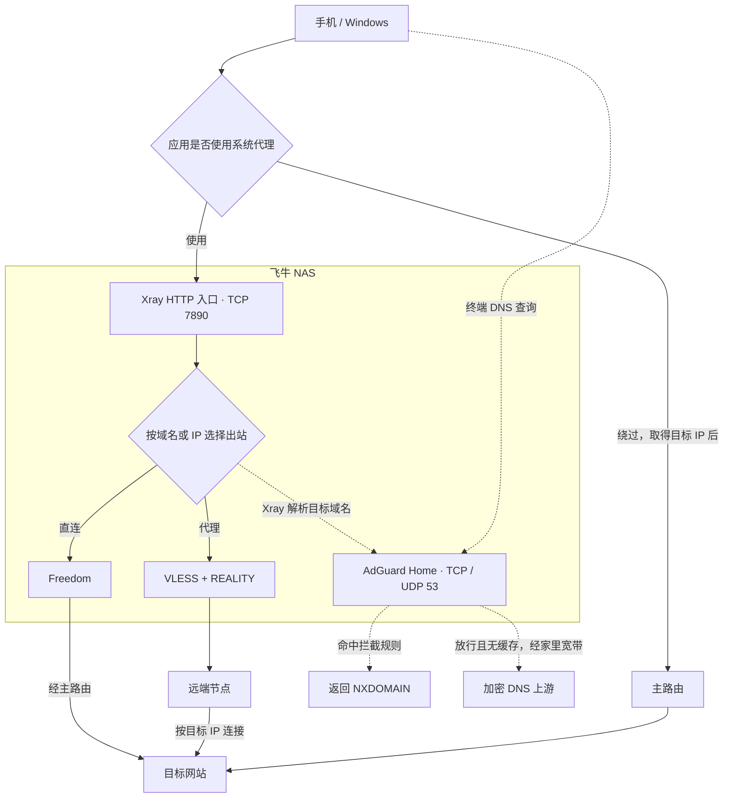
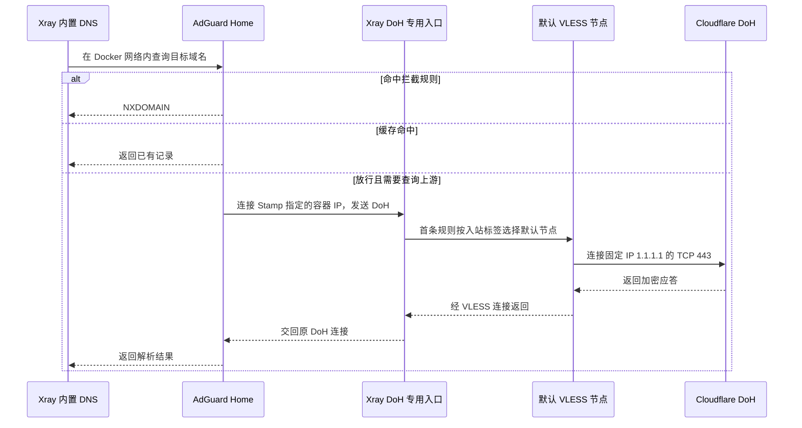
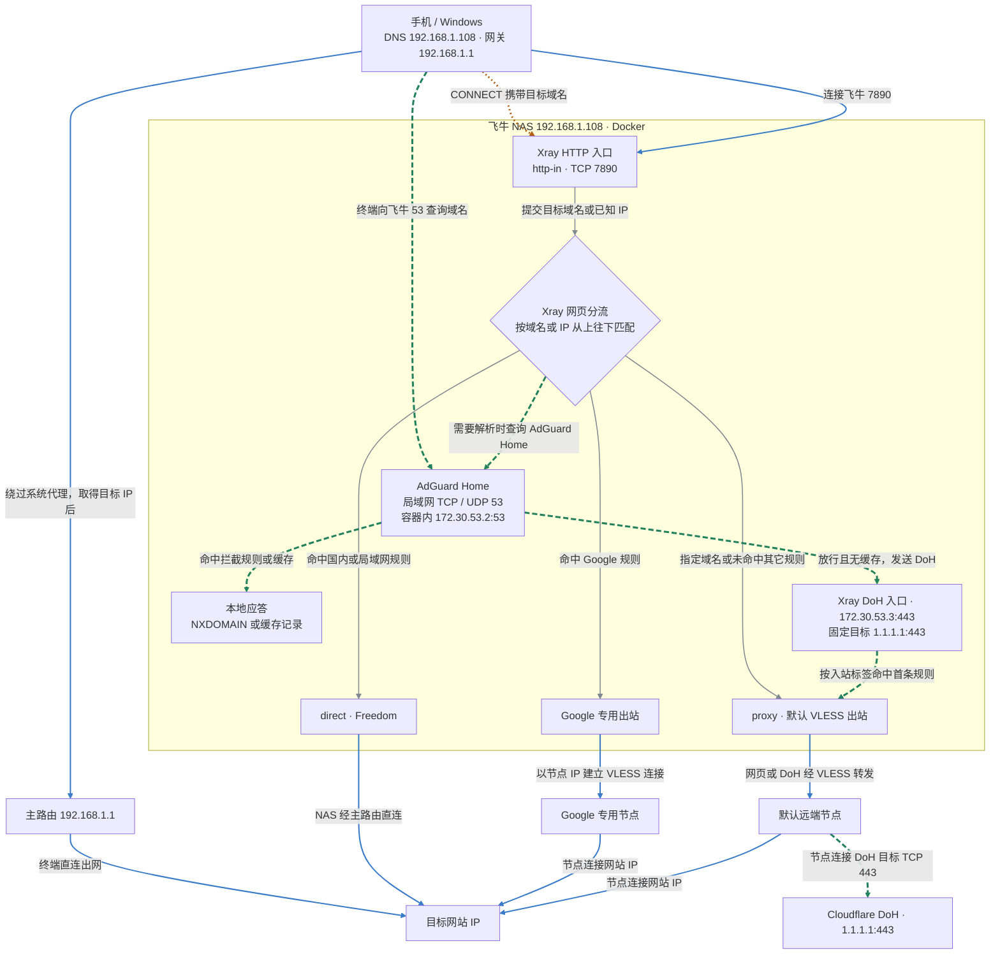

（本文由 AI 协助整理）

家里有一台搭载 Intel N150 的飞牛 NAS，平时用来存文件。这次把它用作局域网里的 HTTP 代理和 DNS 服务器。手机和 Windows 可以在系统里填代理地址，主路由继续提供 DHCP 和默认网关。部署最费心的部分是把三件事讲清楚：谁拿到了目标域名、谁负责查 DNS、最后是谁在连接网站。

## 需求分析

- **接入简单。** Windows 和手机使用系统自带的 HTTP 代理。需要走代理的应用把连接交给 NAS，同一局域网里的文件共享等业务可以直接访问。
- **按目标选择出口。** 国内网站和局域网服务走直连，其他网站走远端节点。Google 等指定域名可以选另一条线路。上游节点要支持 VLESS + REALITY，也留出 IPv6 节点和 Hysteria2 的接入空间。
- **在 NAS 集中过滤广告域名。** 终端直连时由终端查询 AdGuard Home，经过代理时由 Xray 查询 AdGuard Home。需要向上游查询时，让 DoH 也经远端节点出网。
- **部署好维护。** NAS 还要承担日常文件存储，代理和 DNS 用两个独立的 Docker Compose 项目管理。N150 的实际代理吞吐需要单独测试。

系统 HTTP 代理的覆盖范围取决于应用。浏览器通常会遵循它，使用自有网络栈的应用、游戏和语音软件可能直接联网。经典 HTTP CONNECT 转发的是 TCP 连接，普通的 UDP 和 QUIC 流量不会自动进入 NAS 的 HTTP 代理入口。 [Windows 系统代理](https://support.microsoft.com/en-us/windows/experience/connectivity-networking/use-a-proxy-server-in-windows) · [Chromium 代理说明](https://chromium.googlesource.com/chromium/src/+/HEAD/net/docs/proxy.md)

## 方案设计

### 从 Mihomo 初案到 Xray

最初比较了 Mihomo、v2rayA 和 OpenWrt。Mihomo 管理订阅和代理组方便，也能用域名规则 `REJECT` 广告请求。v2rayA 的 Web 界面适合导入节点和切换出站。OpenWrt 适合要接管路由、VLAN 或做透明代理的场景。这里用 Docker bridge 发布几个局域网端口就能接入，虚拟机也可以实现，但会多维护一套系统和网络。 [Mihomo 路由规则](https://wiki.metacubex.one/en/config/rules/) · [v2rayA](https://github.com/v2rayA/v2rayA) · [Docker bridge 网络](https://docs.docker.com/engine/network/drivers/bridge/)

初案是 **Mihomo + AdGuard Home**。Mihomo 的 `REJECT` 匹配的是应用请求里的域名，AdGuard Home 匹配的是发给它的 **DNS 查询**。浏览器使用 HTTP 代理时，可以先连接 NAS 的 IP，再发送 `CONNECT example.org:443`。随后，代理可以把目标域名交给远端节点解析。若解析在远端完成，即使终端的系统 DNS 已经指向 AdGuard Home，本地也可能看不到这次查询。 [HTTP CONNECT](https://www.rfc-editor.org/rfc/rfc9110.html#section-9.3.6) · [Mihomo DNS 流程](https://wiki.metacubex.one/en/config/dns/diagram/)

我想让两类请求使用同一套 DNS 过滤规则，所以最终用了 **Xray + AdGuard Home**。Xray 的出站使用 `ForceIP`，把目标域名交给内置 DNS 解析。内置 DNS 再通过 `tcp+local` 向同一个 Docker 网络中的 AdGuard Home 查询。对于走节点的请求，Xray 把解析得到的目标 **IP** 交给远端；如果解析失败，就结束这条连接。Freedom 直连出站也配置了 `ForceIP`，由 NAS 使用解析结果拨号。 [Xray 内置 DNS](https://xtls.github.io/en/config/dns.html) · [Xray 出站解析策略](https://xtls.github.io/en/config/outbound.html)

这一阶段的基础架构如下。第一版设计里，AdGuard Home 可以经家里宽带直连 DoH 或 DoT 上游。



### 为什么把加密上游也交给节点

这里说的 DNS 泄露，是指查询走出了设定的路径。比如网页经远端节点访问，域名却被发给家里宽带的运营商解析器。直连 DoH 或 DoT 可以加密传输中的 DNS 内容，上游解析器仍能看到查询和家庭出站 IP。把 DoH 经远端节点转发，则由节点发起到解析器的连接。AdGuard Home 保留在链路前段，先过滤，再决定要不要查上游。 [DNS 隐私考量](https://www.rfc-editor.org/rfc/rfc9076.html) · [DoH 隐私说明](https://www.rfc-editor.org/rfc/rfc8484.html#section-8)

参考文章在 Android 上通过 AdGuard 的本机 VPN 接收和过滤应用流量，再把放行流量转给 Clash 的本地代理。DNS 也可以交给 Clash 的本地 DNS 端口。这里借用的是过滤后再转发的思路。NAS 上的 **AdGuard Home** 处理 DNS 查询，网页内容和 HTTPS 过滤则是参考文章里 **AdGuard 客户端**的功能。 [AdGuard 去除广告与 Clash 网络代理共存](https://notion-blog.ichr.me/post/adguard-with-clash) · [AdGuard Android 出站代理](https://adguard.com/kb/adguard-for-android/solving-problems/outbound-proxy/#how-to-use-adguard-with-clash) · [AdGuard Home 简介](https://adguard-dns.io/kb/adguard-home/overview/)

### 上游 DoH 的转发和防循环

把 AdGuard Home 的上游写成 **DoH DNS Stamp**。这个 Stamp 的连接地址是 Xray 容器的 `172.30.53.3:443`，HTTPS 主机名是 `cloudflare-dns.com`，路径是 `/dns-query`。Xray 的 `tunnel` 入口将这条 TCP 连接的转发目标设为固定的 `1.1.1.1:443`。AdGuard Home 与 Cloudflare 建立并校验 TLS，Xray 和节点负责传输字节。 [DNS Stamp 格式](https://dnscrypt.info/stamps-specifications/) · [Xray Tunnel 入口](https://xtls.github.io/en/config/inbounds/tunnel.html) · [Cloudflare 公共解析器端点](https://developers.cloudflare.com/1.1.1.1/infrastructure/network-operators/)



防循环靠各跳拨号时使用固定 IP。Xray 的普通 DNS 查询直达 AdGuard Home 的容器 IP。AdGuard Home 在 Stamp 中拿到 Xray 的容器 IP。Xray 转发 DoH 时，目标解析器和 VLESS 节点也都用 IP 拨号。这样即使普通 DNS 正在等上游回应，建立 DoH 通道也不需要再发起同一套域名解析。节点提供域名时，我在部署时先查到 IPv4 并填进拨号地址，如果该记录变动，需要更新所填 IP。REALITY 的 `serverName` 仍按节点提供的握手参数填写。 [Xray 路由规则](https://xtls.github.io/en/config/routing.html) · [Xray REALITY 配置](https://xtls.github.io/en/config/transports/reality.html)

### 最终的域名、DNS 和 IP 流向

橙色点线表示目标域名随 `CONNECT` 传递。绿色粗虚线表示 DNS 查询，包括封装成 DoH 的上游查询。蓝色实线表示实际 IP 连接，灰线表示 Xray 内部的选路。DNS 应答沿原路返回。



| 应用怎么访问           | 谁发起目标 DNS 查询             | 谁发起到网站的连接                         |
| ---------------------- | ------------------------------- | ------------------------------------------ |
| 终端绕过系统代理       | 终端查 NAS 的 `53`              | 终端经主路由连接目标 IP                    |
| 经 Xray 并命中直连     | Xray 查容器内的 AdGuard Home    | NAS 经主路由连接目标 IP                    |
| 经 Xray 并命中远端代理 | Xray 查容器内的 AdGuard Home    | Xray 把目标 IP 交给所选节点，由节点连接    |
| 直接输入目标 IP        | 一般不需要为这个目标做 DNS 查询 | 终端直接连接，或由 Xray 按 IP 规则选择出口 |

初版主要用域名规则，后续为了按截图匹配中国 IP 和局域网 IP，把路由的域名策略设为 `IPOnDemand`。Xray 在遇到需要比较 IP 的规则时，可以先解析域名。出站的 `ForceIP` 则决定实际拨号使用解析后的 IP。两者可以使用已有缓存结果。以 Google 为例，网页可以走专用节点，缓存未命中的 DNS 查询则走默认节点，因为 DoH 专用入口有自己的首条路由规则。 [Xray 路由策略](https://xtls.github.io/en/config/routing.html#routingobject)

## 实施步骤

### 1. 准备 Compose 项目

本次部署使用飞牛网页端的 Docker Compose。镜像固定为当时验证过的 `adguard/adguardhome:v0.107.80` 和 `ghcr.io/xtls/xray-core:26.11.9`。两个项目分别叫 `adguardhome` 和 `xray`，都接入自定义 bridge 网络 `proxy_dns`。AdGuard Home 项目先创建该网络，Xray 项目再以 `external: true` 加入。 [Docker Compose 网络](https://docs.docker.com/reference/compose-file/networks/) · [AdGuard Home Docker 指南](https://adguard-dns.io/kb/adguard-home/docker/) · [Xray 官方镜像](https://github.com/XTLS/Xray-core/pkgs/container/xray-core)

| 项目         | NAS 上的挂载                     | 对局域网提供的端口                              | Docker 内部地址                               |
| ------------ | -------------------------------- | ----------------------------------------------- | --------------------------------------------- |
| AdGuard Home | `conf` 存配置，`work` 存工作数据 | `192.168.1.108:53`（TCP/UDP），`:13000`（管理） | `172.30.53.2`                                 |
| Xray         | 只读挂载 `config.json`           | `192.168.1.108:7890`（HTTP 代理）               | `172.30.53.3`，DoH 转发监听此地址的 `443/TCP` |

这里的 `443` 只供容器间通信。管理页面使用宿主机端口 `13000` 映射到 AdGuard Home 容器的 `3000`。示例中的地址按各自局域网调整，修改 Xray 容器地址时也要重建包含该地址的 DNS Stamp。

因为节点列表里有 IPv6 地址，共享网络后来重建成双栈。IPv4 用 `172.30.53.0/24`，IPv6 用 ULA 子网 `fd42:30:53:e93a::/64`。飞牛宿主机先用 `ip -6 route get` 检查路由，再以 `curl -6` 访问 Cloudflare，收到 HTTP 200。两个容器重新接入后，飞牛页面也显示该 bridge 已启用 IPv6。这个结果覆盖了宿主机 IPv6 和容器网络的配置，IPv6 节点仍要从容器实测，尤其要区分 VLESS 的 TCP 与 Hysteria2 的 UDP。 [Docker IPv6 网络](https://docs.docker.com/engine/daemon/ipv6/)

### 2. 启动容器并连通 DoH 上游

1. 先启动 AdGuard Home。首次打开管理页面时，管理界面选容器内端口 `3000`，DNS 选 `53`，创建自己的管理员账号。浏览器访问的是 NAS 的 `13000`。
2. 准备 Xray 的 `config.json`。VLESS + REALITY 的 UUID、节点地址、端口、传输方式、`flow` 和 REALITY 握手参数按节点填写。先用 `xray run -test -config` 检查配置，再挂载并启动容器。检查前期配置时，用同版本的核心验证了三条 VLESS 和一条 Hysteria2 出站的语法。
3. 在 AdGuard Home 的 **设置 → DNS 设置**里填入 DoH Stamp，清空备用 DNS，并关闭上游 HTTP/3，因为专用转发入口接收 TCP。拦截模式选 `NXDOMAIN`，测试上游成功后保存。 [AdGuard Home 上游设置](https://adguard-dns.io/kb/adguard-home/configuration/#configuring-upstreams)

### 3. 逐台接入 Windows 和手机

先明确指定服务器测试，等代理和 DNS 都跑通，再写进设备的系统设置。下面两条命令来自当时的验收。

```powershell
Resolve-DnsName example.org -Type A -Server 192.168.1.108 -DnsOnly
curl.exe -I --max-time 20 --noproxy localhost --proxy http://192.168.1.108:7890 https://example.org/
```

Windows 的 `WLAN` DNS 首选地址设为 `192.168.1.108`，系统手动代理设为 `192.168.1.108:7890`，飞牛和路由器管理地址可以加入例外列表。如果本机原先开着 v2rayN 的 TUN，验收时先退出该客户端。用不指定服务器的 `nslookup` 和 AdGuard Home 查询日志检查系统默认 DNS，能补上显式命令只测试了单次查询的局限。 [Windows 代理设置](https://support.microsoft.com/en-us/windows/experience/connectivity-networking/use-a-proxy-server-in-windows)

手机连接同一个家庭 Wi-Fi。在当前网络详情里填 DNS 和手动 HTTP 代理。iPhone 可以分别修改 DNS 和代理，Android 的具体入口随厂商变化，部分机型需要在静态 IP 设置中填写 DNS。若使用静态地址，先在路由器保留该手机的地址，按原网络填写网关和前缀。手机先关闭代理访问一个新域名，查 AdGuard Home 日志，再开启代理并看 Xray 的 `http-in` 访问日志。 [iPhone 无线局域网设置](https://support.apple.com/guide/iphone/iphw5gjwl8k2/ios/27) · [AdGuard Home 设备配置](https://adguard-dns.io/kb/adguard-home/getting-started/#configuring-devices) · [Pixel Wi-Fi 代理设置](https://support.google.com/pixelphone/answer/9655181)

### 4. 验证过滤，再迁移分流规则

初版在 Windows 上用 `example.org` 完成了三轮测试，手机也通过了接入测试。

| 状态                                       | 直接查询 AdGuard Home | 经 NAS 的 HTTPS 请求                                         |
| ------------------------------------------ | --------------------- | ------------------------------------------------------------ |
| 未添加临时规则                             | 返回 A 记录           | CONNECT 成功，目标站返回 `200 OK`                            |
| 添加临时规则 `\|\|example.org^` 并清理缓存 | 返回 `NXDOMAIN`       | 代理先返回 `200 Connection established`，随后的 TLS 握手失败 |
| 删除临时规则并复测                         | 恢复 A 记录           | 恢复目标站的 `200 OK`                                        |

`200 Connection established` 表示代理接受了 CONNECT。测试实际访问时，要看接下来有没有目标站的响应。要单独确认 DoH 路径，可以挑一次缓存未命中的查询，对照 AdGuard Home 的查询日志和 Xray 的 `dns-upstream-in -> proxy` 记录，目标应当是 `1.1.1.1:443`。DoH 会复用连接，同一条连接上的后续查询可以共用首条 Xray 连接日志。 [HTTP CONNECT](https://www.rfc-editor.org/rfc/rfc9110.html#section-9.3.6) · [AdGuard DNS 过滤规则](https://adguard-dns.io/kb/general/dns-filtering-syntax/)

完成单域名验证后，我把 v2rayN 截图里的规则迁移到 Xray，按从上到下的顺序匹配。DoH 专用入站规则放在最前面，随后是 Steam 下载、微软、指定阿里云资源、指定代理域名、Google 专用线路和 UDP 443 拦截。后面是局域网 IP 和域名、截图里的 35 个中国公共 DNS IP、5 个公共 DNS 域名、`geoip:cn` 和 `geosite:cn`。最后一条把未命中的 HTTP 代理请求送给默认节点。Google 的两条规则按原顺序保留，前一条先命中，后一条不会充当节点故障时的备用出口。 [Xray 路由规则](https://xtls.github.io/en/config/routing.html) · [v2rayN 规则说明](https://github.com/2dust/v2rayN/wiki/Description-of-some-ui)

替换配置用 Xray 26.11.9 和对应镜像的 GeoIP、GeoSite 数据在本地检查过，验证了 17 个路由结果。NAS 换配置后的复测中，Google 和 `example.org` 经代理返回了 `200 OK`。B 站和百度当时在 CONNECT 后未完成 TLS 握手，直接查询飞牛 DNS 也超时。那台 Windows 仍有 TUN 在运行，WLAN 也列着运营商的 DNS。这些现象只能作为定位线索，国内直连和更新后 DoH 链路的最终验收尚未记录。下一次复测应先退出本机 TUN，再用 AdGuard Home 和 Xray 日志逐跳核对。

## 注意事项

- **先在单台设备上验证，再决定是否由主路由下发 DNS。** 这套设计把缓存未命中的公网 DNS 查询交给默认节点，节点不可用时，新的公网解析可能失败，连本来要直连的网站也会受影响。
- **把终端代理、DNS 和网关分别检查。** Windows 的 TUN、路由器下发的 IPv6 DNS，以及手机或浏览器配置的独立加密 DNS，都可能改变终端的实际查询路径。测试时看查询日志和出站标签，避免只凭页面能打开判断。
- **保持局域网访问范围。** DNS、HTTP 代理和管理端口绑定在 NAS 的局域网地址上。路由器侧避免给它们做公网端口转发，节点凭据放在受限目录的配置文件里。
- **区分 Docker IPv6 和 DNS 结果类型。** Xray 可以用 IPv6 连接写在配置里的节点地址，同时让自己的目标域名解析采用 IPv4。调整查询策略和接入 IPv6 节点是两处不同的设置。

## 问题汇总

### 为什么换了 DNS，某些请求依然没有去广告？

AdGuard Home 只能过滤送到它的 DNS 查询。直接用 IP、沿用尚未失效的结果、自行使用其他解析器的应用，都可能缺少这次过滤机会。广告和正文如果使用同一个域名，DNS 过滤也无法只去掉其中某个 URL。经 HTTP 代理的域名请求由 Xray 通过 `ForceIP` 使用本地过滤结果。 [AdGuard Home FAQ](https://adguard-dns.io/kb/adguard-home/faq/) · [Xray 目标地址策略](https://xtls.github.io/en/config/outbound.html)

### 为什么重建以后才显示 Docker 网络启用了 IPv6？

IPv6 是 bridge 网络的创建属性。先释放旧容器的网络连接，再由 AdGuard Home 项目的 Compose 创建双栈网络，随后启动加入该网络的 Xray 项目。AdGuard Home 的数据和 Xray 配置通过宿主机目录挂载，重建容器时保留这些目录。测试 IPv6 节点时还要分别验证 TCP 或 UDP 到节点端口的连通性。 [Docker 自定义 bridge 的 IPv6 设置](https://docs.docker.com/engine/network/drivers/bridge/#use-ipv6-in-a-user-defined-bridge-network)

### N150 能不能跑到千兆？

这次实测覆盖的是连通性、过滤和分流，没有跑饱和带宽测试。Intel N150 支持 AES-NI，可以加速适用的加密运算。总吞吐还受单连接处理、远端节点限速、宽带、网口、所用协议和 NAS 同时传文件的影响。要验证千兆，先用有线电脑建立局域网带宽基线，再用同一节点测单连接和多连接代理下载，同时观察单核占用与网口速率，最后叠加 SMB 大文件传输复测。 [Intel N150 规格](https://www.intel.com/content/www/us/en/products/sku/241636/intel-processor-n150-6m-cache-up-to-3-60-ghz/specifications.html)
